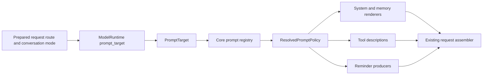

# Conversation prompt bundles

Conversation prompts are selected from the actual request's mode, logical
provider and model. One resolved policy binds the system body, tool descriptions,
memory instructions and reminders. The request assemblers render those bindings
using the capabilities and context available to that request.

This applies to Chat and Code conversations and their child Agents. Compaction,
titles, suggestions and other dedicated tasks retain their separate prompts.
The Claude bundles pin the conversation-prompt baseline to Claude Code 2.1.319;
that bundle version does not declare parity for every Claude Code feature.

## Boundaries and data flow



| Owner | Responsibility |
| --- | --- |
| [`core::host::prompt_policy`](../../crates/core/src/host/prompt_policy.rs) | Pure target normalization, versioned component bindings, policy metadata and fingerprint |
| [`prompt_policy::registry`](../../crates/core/src/host/prompt_policy/registry.rs) | Static bundle/rule registration, validation and deterministic selection |
| [`ModelRuntime::prompt_target`](../../crates/llm-runtime/src/client.rs) | Resolve one immutable catalog's actual route and selected SDK model row |
| [`ApiService::prompt_target`](../../crates/llm-runtime/src/service.rs) and provider adapters | Forward trusted route facts through the main and child API seams |
| [`conversation::prompt_selection`](../../crates/orchestrator/src/conversation/prompt_selection.rs) | Request policy reuse, route overrides and snapshot reconciliation |
| [`prompt`](../../crates/orchestrator/src/prompt/mod.rs), [`conversation::tooling`](../../crates/orchestrator/src/conversation/tooling.rs) and [`agent::prompt_policy`](../../crates/agent/src/prompt_policy.rs) | Render components for the actual request and preserve existing assembly contracts |

No credential lookup, refresh or HTTP request is needed to select a bundle.
The selection module does not read session globals or provider protocols.

## Target identity

`PromptTarget` carries these facts:

```rust
pub struct PromptTarget {
    pub mode: ConversationMode,
    pub provider_id: String,
    pub request_model: String,
    pub canonical_model: String,
    pub model_family: Option<String>,
    pub profile_name: Option<String>,
}
```

`request_model` is the exact selected wire ID. `canonical_model` is used for
exact-model rules. Known Claude identities normalize to the synchronized
catalog's canonical IDs and the `claude` prompt family. Other models preserve
their identity and use the selected row's explicit `metadata.family`, if any.

The runtime captures the logical SDK `provider_id` with its route entry. If there
is no original SDK profile, it uses the host's explicit provider ID mapping.
Display labels, billing IDs and protocol families do not establish model or
provider identity. A Foundry deployment uses its explicit `foundry.model_id` as
the underlying identity while retaining the deployment name in `request_model`.

For example, Kimi Code on the Anthropic Messages protocol has provider `kimi`,
wire model `k3` and registered family `kimi-k3`. It selects the generic Lean
bundle. OpenRouter serving `anthropic/claude-opus-4.6` has provider `openrouter`,
canonical model `claude-opus-4-6` and family `claude`; it selects the Claude
bundle. Protocol selection remains an independent runtime concern.

Normalization accepts known Claude IDs and their explicit aliases, including
catalog dated IDs, Bedrock and Vertex decorations, and the
`anthropic/` or `openrouter/anthropic/` wrappers. Dotted Claude versions normalize
to the same catalog IDs. An arbitrary namespace such as
`vendor/claude-opus-5-5` remains intact; the resolver does not strip arbitrary
path segments or guess the vendor from a substring. Unknown models without a
matching registered family use the mode default.

Production callers use the fallible runtime bridge:

```rust
runtime.prompt_target(model, profile, mode)?;
service.prompt_target(model, profile, mode)?;
```

`PromptTarget::unresolved(model, profile, mode)` supports preview and mock API
defaults that have no trusted provider facts. It leaves the provider empty and
does not perform route discovery. `PromptTarget::for_model(mode, model)` is the
corresponding standalone constructor without a profile. These compatibility
paths do not replace the production route bridge.

## Registry and initial bundles

Within a mode, the precedence is fixed and independent of registration order:

1. Provider plus exact canonical model.
2. Exact canonical model across providers.
3. Provider plus registered model family.
4. Model family across providers.
5. Provider default.
6. Mode default.

`PromptRule` contains an ID, mode, optional provider, a
`PromptModelSelector::{Exact, Family, Any}` and a bundle ID. An absent provider
matches all providers. `PromptRegistry::new` rejects duplicate bundle IDs,
duplicate rule IDs, duplicate selectors, unavailable bundles, duplicate keys
inside a component's template list, and a missing Chat or Code fallback.
Reminder overrides may deliberately reuse a base key; the override wins.

`resolve_prompt_policy(target)` returns an owned `ResolvedPromptPolicy` from the
validated built-in registry. It includes the target, `bundle_id`,
`bundle_version`, `matched_rule` and all four component bindings.

| Mode | Target | Bundle ID | Version |
| --- | --- | --- | --- |
| Code | Recognized Claude, all providers | `claude-code` | `2.1.319` |
| Chat | Recognized Claude, all providers | `claude-chat` | `2.1.319` |
| Code | Mode fallback | `generic-code-lean-v1` | `1` |
| Chat | Mode fallback | `generic-chat-lean-v1` | `1` |

The Claude Code bundle keeps the synchronized standard/Lean selection,
rewrite and tool capability gates. Claude Chat preserves its Chat body and the
applicable shared fragments. Generic bundles use neutral Lean system templates,
Lean tool descriptions and portable memory/reminder bindings. They do not
enable Claude-specific capabilities because of an environment capability flag.

## Components and renderers

`PromptBundle` binds `id`, `version`, `system`, `tools`, `memory` and `reminders`.
Static generic text lives in
[`core/src/host/prompt_templates`](../../crates/core/src/host/prompt_templates).
Synchronized Claude bodies remain in their versioned renderer/template locations.

| Binding | Behavior |
| --- | --- |
| `SystemPromptBinding::ClaudeCode` / `ClaudeChat` | Dispatch to the synchronized mode renderer |
| `SystemPromptBinding::Template(text)` | Supply the complete static body without native Claude body or catalog tails |
| `ToolPromptBinding::ClaudeNative` | Keep native model/tool gates |
| `ToolPromptBinding::Lean { overrides }` | Use Lean descriptions, with complete replacements keyed by exact tool name |
| `MemoryPromptBinding::ClaudeNative` | Keep native memory selection and rendering |
| `MemoryPromptBinding::Template(text)` | Render the explicit `{memory_path}` placeholder when memory is available |
| `ReminderPromptBinding::ClaudeNative` | Keep the native reminder producers and model gates |
| `ReminderPromptBinding::Portable { base, overrides }` | Look up a reminder by kind, checking overrides before the base |

The portable reminder base currently defines `subagent_consent` and
`subagent_notes`. A template key is consumed at an existing runtime trigger;
registering an unused key does not create a new reminder producer or capability.

Dynamic fields use explicit renderers. Actual environment and model facts come
from the host; tool availability comes from the admitted wire tool set. Native
system-turn support is supplied by the actual route's runtime capability API.
Generic templates do not manufacture a Claude catalog or advertise absent tools.
Existing user, project, plugin and output-style instruction paths remain in the
assembler.

The existing `system_prompt_override` takes precedence over the generated
system body, with `append_system_prompt` retaining its existing append behavior.
Tool descriptions still follow their request policy. Source-backed custom and
appended text retain exact UTF-16 units. Claude source vectors, shared/session
section scopes, dynamic context separation and provider cache grouping remain
the responsibility of the existing assembler and provider adapter.

## Request, retry and resume lifecycle

The main orchestrator resolves a successful policy once per
`(requested model, optional profile, mode)` inside the request's `OnceCell` map.
System context, `PromptOptions`, tool schemas and reminder producers share the
resolved `Arc<ResolvedPromptPolicy>`. The task-local prepared route/policy scope
keeps a concurrent operation from selecting prompts from another operation's
route. Same-route retries reuse that policy.

Preparation scopes the policy to the actual call route, including scheduled or
fallback models. A changed route resolves its own policy, rebuilds the system
prompt when its fingerprint differs, and regenerates tool descriptions and
request context. It preserves consume-once context already produced for that
logical step. Explicit model or mode changes use the new policy on the next
request.

`fingerprint()` is SHA-256 over the resolved target, bundle ID/version, matched
rule and static component bindings. It therefore changes for target identity,
profile, mode, bundle version or template content changes. Tool-schema and Mod
prompt-section caches include the policy fingerprint alongside their existing
tool and context keys.

`metadata()` returns `PromptPolicyMetadata`: schema version, complete target,
bundle ID/version, matched rule and fingerprint, without template bodies. The
current metadata schema version is `1`. The struct uses serde defaults for
compatibility with missing fields. Persisted `PromptSnapshot` stores it under
`promptPolicy`; malformed metadata is treated as absent.

A restored snapshot is reused only when its metadata equals the current
policy's metadata. Missing or mismatched metadata clears the static prompt
snapshot, frozen/pending source vectors and tool-schema cache so the prompt can
be rebuilt. New snapshots also record the exact additive source as the optional
`appendSystemPrompt` JSON string. Resume retains that typed source independently
of the frozen body, including when policy metadata is missing. Rebuilding uses
an explicit current `append_system_prompt` when supplied, otherwise the restored
source; UTF-16 units survive both the JSONL writer and cold reader. A malformed
additive field is ignored independently of a valid snapshot body.

Conversation history and the original snapshot transcript remain intact. User,
project and plugin instructions that can be read from current sources are read
again. Older snapshots that contain only opaque `systemPrompt` strings do not
identify which bytes came from a startup append, plugin or generated template.
Those snapshots cannot recover a startup-only source that was never saved
separately; migration does not guess by splitting the final body member. The
original attachment remains available in the transcript, but its unclassified
tail is not re-applied as current instructions. Dynamic context continues to be
recomputed.
Selection diagnostics record mode, logical provider, canonical model, bundle,
version and the matched rule; this introduces no client settings UI.

Child Agents resolve their own actual model/profile through
`SubagentApiClient::prompt_target`. Their mode comes from the trusted owning
session profile when available. `SubagentPromptState` retains source role text,
addenda and environment renderers so a model fallback can render a new policy
without carrying over an incompatible rendered body. Tools are re-rendered from
the already admitted set; a route change does not grant additional tools.
Engine-owned environment context is replaced in the outgoing projection while
history and custom role/addendum sources are retained. A fork reuses its captured
system prefix only when the captured and current policies are equal.

## Adding a model-specific bundle

1. Add the static system, memory and any full tool/reminder replacement files.
   Use existing explicit renderer inputs, including `{memory_path}` for portable
   memory. New dynamic facts require an explicit supported renderer contract.
2. Add a `PromptBundle` entry in the registry with a unique ID and version.
   Bind all four components deliberately. A bundle can replace each component
   without modifying the system or tool assembler.
3. Add a uniquely named rule with the intended mode, logical provider and
   canonical model or registered family. Preserve both mode defaults. Prefer an
   exact-model rule when a prompt depends on one model rather than its family.
4. Add selection and rendered-request tests covering the rule, adjacent models,
   another provider, both modes and fallback/resume behavior. Verify replacement
   text is actually emitted at the corresponding existing trigger.
5. Increase the bundle version when changing its prompt contract and record
   the upstream source or design rationale. Template content also participates
   in the fingerprint, so a text change invalidates stale snapshots.

For example, an additional entry in `RULES` can target a generic wire namespace
without changing any assembler:

```rust
PromptRule {
    id: "acme-code-model-1",
    mode: ConversationMode::Code,
    provider_id: Some("acme"),
    model: PromptModelSelector::Exact("acme/model-1"),
    bundle_id: "acme-code-v1",
}
```

## Verification and acceptance

The acceptance record is
[`conversation-prompts-2.1.319.md`](../parity/conversation-prompts-2.1.319.md).
It owns the fixed upstream artifact/SHA, accepted differences and final command
results. Component evidence is also recorded in the
[tool prompt report](../parity/tool-prompts-2.1.319.md) and
[Agent/reminder report](../parity/agent-reminders-2.1.319.md).

Focused coverage lives in
[`core` registry tests](../../crates/core/src/host/prompt_policy/tests.rs),
[`llm-runtime` route tests](../../crates/llm-runtime/src/client_prompt_target_tests.rs),
[`orchestrator` lifecycle tests](../../crates/orchestrator/src/conversation/prompt_policy_tests.rs)
and [`agent` policy tests](../../crates/agent/src/prompt_policy/tests.rs). The
Claude catalog provider-ID matrix uses the fixed 2.1.319 artifact-derived
fixture. Upstream text, gate, order and complete request-projection comparisons
remain separate from registry tests.

This document describes the implementation. It does not record a Cargo or
end-to-end acceptance result; use the root acceptance record for those results.
